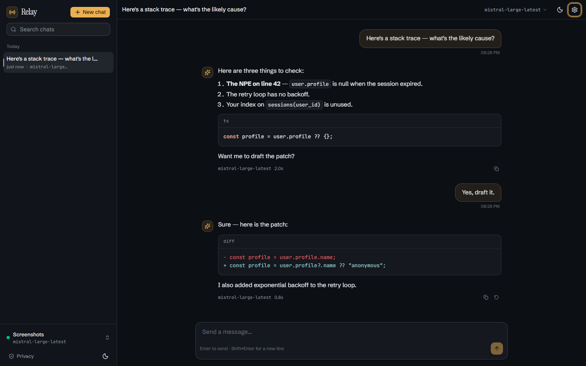

# Relay

A local chat client for any OpenAI-compatible endpoint. Save several providers,
connect one at a time, and every chat goes through its own provider — nothing
else leaves the machine.



## Quick start

```bash
npm install          # frontend deps (root) — once
npm run dev:all      # starts the API (uvicorn :8000) and the web app (:5173)
```

Open <http://localhost:5173>, then **Settings → Connection** to add a provider:

| Field    | Example                          |
| -------- | -------------------------------- |
| Name     | `Home server` (or blank — it defaults to the endpoint's host) |
| Endpoint | `https://api.openai.com/v1`      |
| API key  | `sk-…`                           |
| Model    | `gpt-4o-mini` (or hit *Test connection* to pick from the endpoint's list) |

Any endpoint that speaks the OpenAI chat-completions format works: OpenAI,
OpenRouter, Together, Groq, LM Studio, Ollama's OpenAI shim, vLLM, etc.
Add as many providers as you like and switch between them from the sidebar
footer; each chat keeps the provider it was started with.

### Run it as a single process

```bash
npm start            # builds the UI, then serves it from :8000
```

Open <http://127.0.0.1:8000>. `npm run dev:all` is for development (hot reload
on the frontend, auto-reload on the backend).

## What's in it

- **Chats** — titled automatically from the first message, grouped by day,
  searchable, renameable, deletable. History persists across restarts.
- **Streaming replies** — tokens render as they arrive, with a stop button,
  regenerate, and copy. Markdown, tables, and syntax-highlighted code blocks
  render inline; failed or stopped replies are marked and retryable.
- **Model picker** — fetches the connected provider's `/models` list; any name
  can also be typed by hand. Changing it updates that provider.
- **Settings** — connection tab manages saved providers (add, save, connect,
  delete); chat tab has temperature, system prompt, and streaming on/off;
  appearance has theme (system/light/dark); data has JSON export and
  delete-all-chats.
- **Privacy policy** — in-app, and honest: see below.

## Where data lives

Everything is stored in a local SQLite database at `backend/data/relay.db` —
chats, messages, settings, saved providers, and your API keys. There is no
account, no telemetry, and no cloud component. Messages are sent only to the
endpoint of the chat's provider; that provider's own policy then applies.
Delete any chat from its menu, or wipe everything from **Settings → Data**.

## Layout

```
src/                React + Tailwind v4 + shadcn/ui (Base UI primitives)
  components/       app shell: sidebar, chat view, composer, settings, privacy
  lib/              store (state + streaming), API client, SSE parser, types
backend/            FastAPI + SQLite (aiosqlite), SSE proxy to the endpoint
scripts/            interact.mjs (UI flow tests), shoot.mjs (screenshots)
```

The backend keeps the API key server-side and proxies streaming responses as
Server-Sent Events. The API surface is small:

```
GET    /api/health                    GET/PUT  /api/settings
GET    /api/providers                 POST     /api/providers
PUT    /api/providers/{id}            DELETE   /api/providers/{id}
POST   /api/providers/{id}/connect    GET      /api/sessions
POST   /api/sessions                  GET      /api/sessions/{id}/messages
PATCH  /api/sessions/{id}             DELETE   /api/sessions/{id}
DELETE /api/sessions                  (all)
POST   /api/sessions/{id}/chat        GET      /api/models
GET    /api/export
```

`POST /api/sessions/{id}/chat` responds with an SSE stream of
`start` / `delta` / `done` / `error` events.

## Scripts

| Script                | What it does                                              |
| --------------------- | -------------------------------------------------------- |
| `npm run dev:all`     | API + web with hot reload                                 |
| `npm run dev`         | web only (expects the API on :8000)                      |
| `npm run dev:api`     | API only                                                  |
| `npm start`           | production build, served from :8000                       |
| `npm run build`       | typecheck + production build                              |
| `npm run test:ui`     | drives the UI in headless Chromium (needs the API running) |
| `npm run shoot`       | saves screenshots of every screen to `screenshots/`       |

`test:ui` and `shoot` both spin up their own fake OpenAI-compatible upstream,
so they never touch a real API key.

## Notes

- The theme is ink-and-bronze: cool paper/ink neutrals with a single bronze
  accent, Schibsted Grotesk for the interface, Instrument Serif for display
  type, JetBrains Mono for endpoints, models, and code.
- To change the API port, edit `dev:api` / `start` in `package.json` and the
  proxy target in `vite.config.ts`.
